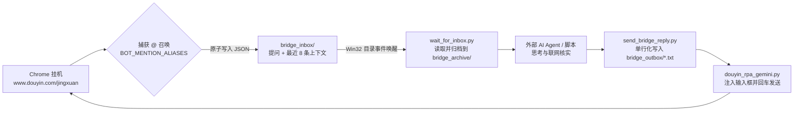

# Douyin Group RPA Bridge

> 基于 **Playwright 浏览器自动化 + React Fiber 消息穿透 + Win32 事件驱动桥接 / OpenAI 兼容大模型** 的抖音网页版群聊 `@` 实时应答机器人。

无需逆向私密协议或官方企业号 API，直接挂机 `www.douyin.com` 消息抽屉即可实现**个人号群聊 `@` 实时监听、多轮上下文抓取、单行安全发送**，并原生支持接入 **AI Agent 本尊实时接管（Bridge 模式）** 或 **独立 OpenAI 兼容大模型（支持百度移动联网搜索）**。

---

## ✨ 核心特性

- **方案 A · 事件驱动本尊桥接（`--bridge`）**：
  - RPA 仅负责监听群聊并维护对话上下文，捕获 `@` 召唤后将提问与最近 8 条上下文原子写入 `bridge_inbox/*.json`。
  - 通过 `wait_for_inbox.py` 基于 Win32 `FindFirstChangeNotificationW` 实现零轮询目录唤醒，交由 AI Agent 本尊联网检索并作答，再通过 `send_bridge_reply.py` 注入 `bridge_outbox/` 发出。
- **独立大模型模式（无参数启动）**：
  - 基于 OpenAI 兼容协议（DeepSeek、Gemini OpenAI 兼容端点等），内置 `web_search` Function Calling 工具（通过百度移动搜索直连抓取实时结果），并自动过滤模板化 AI 客服腔。
- **React Fiber 原生消息提取**：
  - 直接穿透抖音网页版消息节点的 `__reactFiber$` 读取内部 `parsedContent`，免疫前端混淆 CSS 类名频繁改版，单条支持最长 `20000` 字符长文本。
- **精准发送者识别与去重基线**：
  - 结合列表中心线 `midX`、头像坐标归属及倒序连续气泡继承算法区分自己与群友发言；启动自动基线化当前可见历史消息并持久化缓存 `processed_history.json`，重启不重发。

---

## 🔄 架构流程（Bridge 模式）



---

## 📂 目录结构

```text
douyin-rpa-bridge/
├── douyin_rpa_gemini.py      # 主 RPA 守护进程（--login / --bridge / 独立模式）
├── wait_for_inbox.py         # Win32 零轮询收件箱事件监听器
├── send_bridge_reply.py      # 原子化单行回复投递器
├── llm_client.py             # 独立模式 OpenAI 兼容客户端与提示词工程
├── web_search.py             # 免外网代理的百度移动实时搜索封装
├── config.py                 # .env 环境变量配置加载器
├── switch_rule.py            # 可选：Clash Verge / Mihomo 切换 rule 模式脚本
├── personas/                 # 角色人设模板目录
│   ├── persona-Gemini.md
│   └── persona-Cyrene.md
├── .env.example              # 配置模板（请复制为 .env 使用）
├── requirements.txt          # Python 依赖清单
└── LICENSE                   # MIT License
```

---

## 🚀 快速开始

### 1. 安装依赖

要求 Python 3.10+ 及本机已安装 Google Chrome。

```bash
git clone git@github.com:Anona03/douyin-rpa-bridge.git
cd douyin-rpa-bridge
pip install -r requirements.txt
playwright install chromium
```

### 2. 配置 `.env`

```bash
copy .env.example .env   # Windows
# cp .env.example .env # macOS / Linux
```

编辑 `.env` 设置你要监听的群名与 `@` 别名：

```ini
TARGET_GROUP=你的抖音群聊名称
BOT_MENTION_ALIASES=机器人昵称,你的账号名,Gemini
```

若使用独立大模型模式，还需填入兼容接口参数：

```ini
LLM_API_KEY=sk-xxxxxxxx
LLM_BASE_URL=https://api.deepseek.com
LLM_MODEL=deepseek-chat
PERSONA_FILE=personas/persona-Gemini.md
```

### 3. 首次扫码登录（保存登录态）

```bash
python douyin_rpa_gemini.py --login
```

在弹出的 Chrome 窗口完成抖音网页扫码登录（可顺便点击顶部【消息】确认目标群聊可见），回到终端按 `Enter` 即可将持久化登录态写入 `browser_profile/`（该目录已被 `.gitignore` 忽略，**切勿提交到仓库**）。

### 4. 启动守护与桥接交互

**方式一：Bridge 桥接模式（推荐）**

1. 启动群聊 RPA 守护进程：
   ```bash
   python douyin_rpa_gemini.py --bridge
   ```
2. 挂载收件箱事件监听器（收到 `@` 后自动输出 JSON 并退出，适合接入 AI Agent 编排工作流）：
   ```bash
   python wait_for_inbox.py
   ```
3. 发送回复（自动去除换行符，防止抖音富文本输入框误触发“不能发送空白消息”）：
   ```bash
   python send_bridge_reply.py "你好呀，已收到你的 @ 召唤！"
   ```

**方式二：独立大模型全自动模式**

```bash
python douyin_rpa_gemini.py
```

---

## 🛠️ 常见问题排查

- **提示 `ProcessSingleton` / 浏览器打开失败**：同一个 `browser_profile/` 目录同一时刻只能被一个 Chrome 进程锁定，请先退出已有守护进程再重启。
- **发出“不能发送空白消息”或换行截断**：抖音网页版 `contenteditable` 输入框在 `execCommand('insertText')` 时会把 `\n` 当成提前回车提交，请始终使用 `send_bridge_reply.py` 或保证输出为无换行符的单行纯文本。
- **抖音页面超时或异常**：若本机开启了代理工具（如 Clash Verge / Mihomo）且处于 `global` 模式，请切换为 `rule` 规则分流模式（可配置环境变量后运行 `python switch_rule.py`）。
- **视频卡片识别范围**：当前仅提取气泡与卡片的文案字段（`pc.text || pc.content_title`），暂未自动下载或解析群内转发的视频画面。

---

## ⚠️ 免责声明

- 本项目仅供个人学习浏览器自动化（Playwright）与事件驱动架构交流使用。
- 使用本工具操作个人账号时，请严格遵守平台社区规范，切勿用于恶意刷屏、引流推广或违规内容传播。
